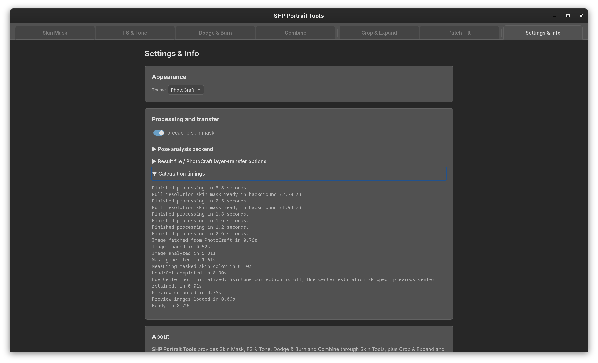

# SHP Portrait Tools

SHP Portrait Tools is a desktop companion for portrait photography on Linux and
Windows. It provides local skin retouching and editable results for PhotoCraft or
Photoshop. Skin analysis runs locally.

The tools estimate each subject's scale (S, in pixels per 63 mm), so size-based
controls adapt to the subject instead of relying on fixed pixel dimensions—helping
keep retouching behavior more consistent across close-ups, wider shots and
resolutions. The Skin Mask focuses adjustments on detected skin and helps reduce
changes to hair, clothing and background; check its coverage and refine it when
needed, since automatic detection can miss or include areas.

<p align="center">
  <a href="docs/images/readme/skin-mask.png"></a>
  <a href="docs/images/readme/fs-and-tone.png"></a>
  <a href="docs/images/readme/dodge-and-burn.png"></a>
</p>

## What’s included

### Skin Tools

- **Skin Mask** — analyze a portrait and inspect or refine the skin mask.
- **FS & Tone** — smooth skin texture and adjust skin tone while retaining detail.
- **Dodge & Burn** — work with editable tonal bands and masks.
- **Combine** — mix frequency-separation and dodge-and-burn results, including local batches.
- **Settings & Info** — source editor, theme, Photoshop pairing and diagnostics.

The skin tools share a source image, analysis and mask settings.

<details>
<summary>View Skin Tools screenshots (6)</summary>




</details>

### AI Fill (now a separate app)

Crop & Expand and Patch Fill moved to their own project,
[SHP AI Fill](https://github.com/stefhartog/shp-ai-fill), which runs as a local web app on
your own ComfyUI. Its settings, presets and results stay in the same data folder, so
existing AI Fill data keeps working there.

### Using results

Load a local image or fetch the current document from a connected editor. Preview
and compare results, then save locally or send editable layers back to PhotoCraft
or Photoshop where supported. An editor is optional for local-file work.

The **Windows Photoshop 28.0 preview** is for Skin Tools. It pairs locally, reads
opaque RGB 8/16-bit documents with the exact source ICC profile, and returns editable
layer stacks, including native Hue Color Lookup. Full fidelity and group masks still
need validation. See [Photoshop setup and limitations](docs/photoshop.md) and the
[connector 0.1.14 CCX](plugins/photoshop/releases/0.1.14/shp.skin-tools.connector_PS.ccx).

## Dependencies

**Required:** Linux or Windows, Git, Python 3.13 and [uv](https://docs.astral.sh/uv/).

**For Skin Tools:** a compatible NVIDIA driver/GPU, the CUDA-enabled Python
dependencies, and three manually supplied ONNX models. The app does not download
these models during installation. See [MODELS.md](MODELS.md#db-three-manually-supplied-onnx-files).

**For the native desktop window:** Linux needs GTK 3, WebKit2 4.1, AppIndicator3
bindings and a tray host; Windows needs the Edge WebView2 Runtime. Standalone web
commands do not require these desktop components.

**Optional:** PhotoCraft or a licensed Photoshop installation for editor integration;
ExifTool and Perl for Sony autofocus-point subject selection.

## Install

On Linux, clone the repository into a new folder, then install its Python environment.
For Windows Skin Tools, see the [Windows setup notes](docs/windows-handoff.md#windows-port-status-skin-tools-standalone).

```sh
git clone https://github.com/stefhartog/shp-portrait-tools.git "$HOME/shp-photocraft-tools"
cd "$HOME/shp-photocraft-tools"
uv python install 3.13
uv sync --locked --extra gpu
```

The `gpu` extra supplies CUDA/cuDNN user-space libraries; it does not install a
graphics driver. For package details
and other dependency options, see [pyproject.toml](pyproject.toml).

If updating an existing environment that had both OpenCV wheels, repair their
shared `cv2` files once with `uv sync --locked --extra gpu --reinstall-package
opencv-contrib-python` (omit `--extra gpu` if not using it). The uv lock excludes
`rtmlib`'s redundant `opencv-python` dependency in favor of the contrib wheel.
Plain pip does not apply uv overrides, and dependency checks may report rtmlib's
`opencv-python` and `onnxruntime` requirements as missing despite the contrib
and GPU variants being installed.

Get the three Skin Tools ONNX models and their documented hashes from
[MODELS.md](MODELS.md#db-three-manually-supplied-onnx-files), then place them in
the model folder:

```sh
mkdir -p "$HOME/.local/share/shp-photocraft-tools/dnb/models"
```

The required filenames are `yunet.onnx`, `face_landmarks.onnx` and
`selfie_multiclass_256x256.onnx`. Once they are in place, install the per-user
desktop launcher and start the app:

```sh
uv run --no-sync python scripts/install_desktop.py \
  --models "$HOME/.local/share/shp-photocraft-tools/dnb/models"
"$HOME/.local/bin/shp-photocraft-tools"
```

Skin analysis also fetches pose-estimation weights on first use; internet access is
needed then unless you prepare the cache in advance.

### Optional standalone commands

Run Skin Tools as a local web app without the native desktop window:

```sh
uv run --no-sync shp-photocraft-dnb --dir "$HOME/Pictures"
```

Open the local address printed at startup. It requires the NVIDIA GPU dependencies
and model files above.

## Guides

- [Fresh Linux setup](docs/portrait-tools-fresh-linux-setup.md) — step-by-step installation.
- [Model requirements](MODELS.md) — model files and licenses.
- [Detailed feature notes](docs/portrait-tools-for-dummies-draft.md) — controls and workflows.
- [Skin Tools developer guide](docs/skin-tools-architecture.md) — module boundaries, request flows, and focused tests.
- [Source provenance](PROVENANCE.md) — upstream project and model references.
