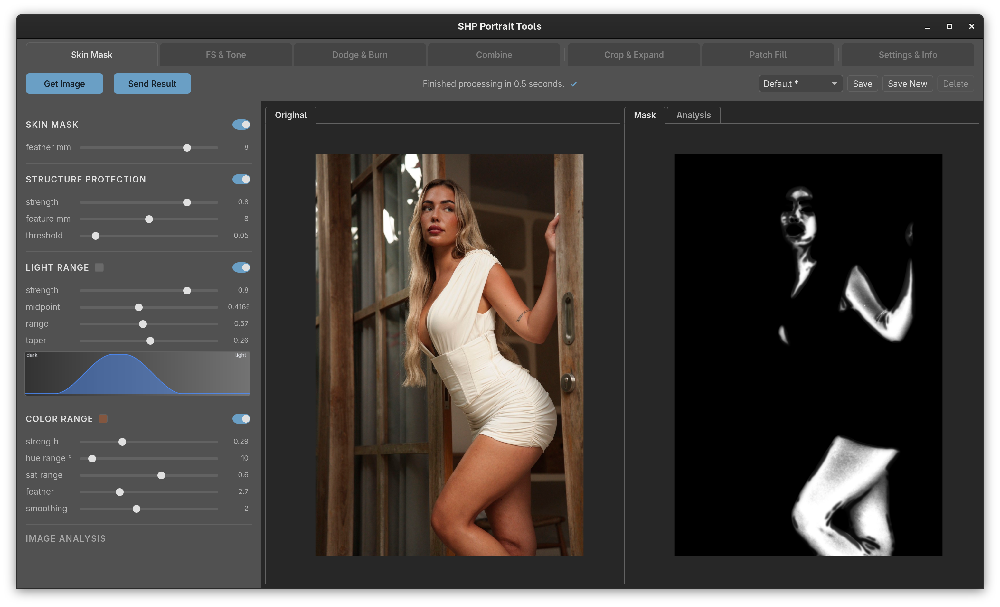
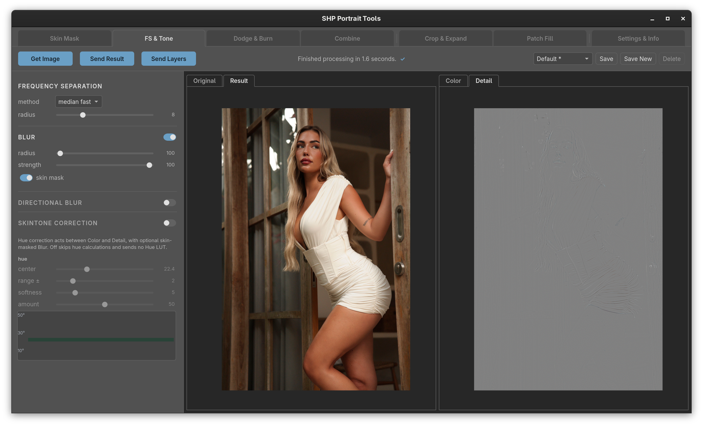
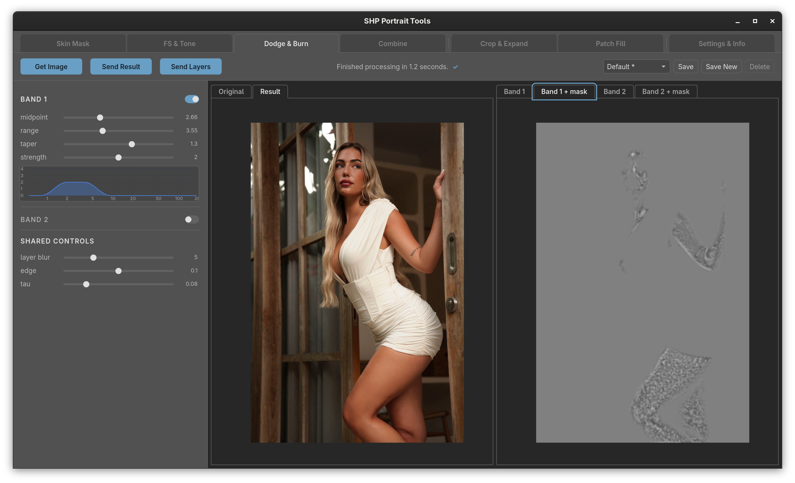
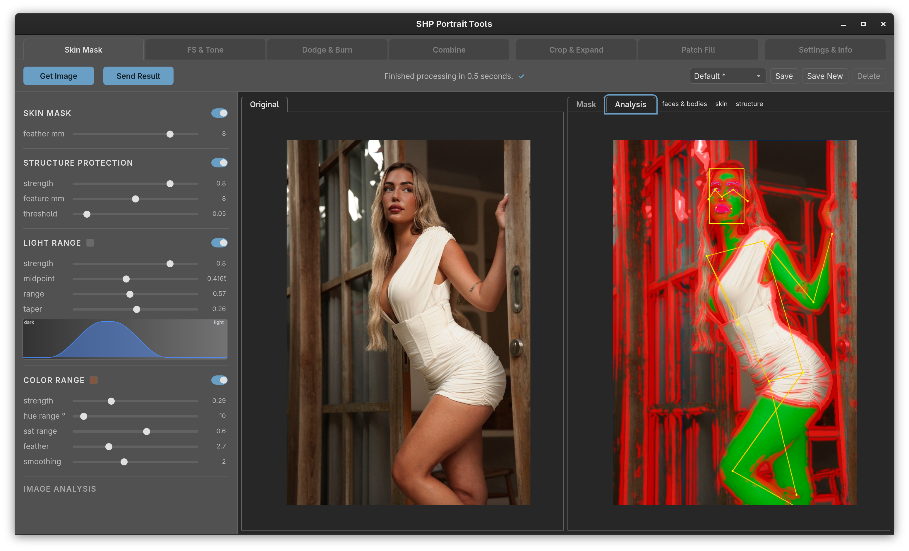
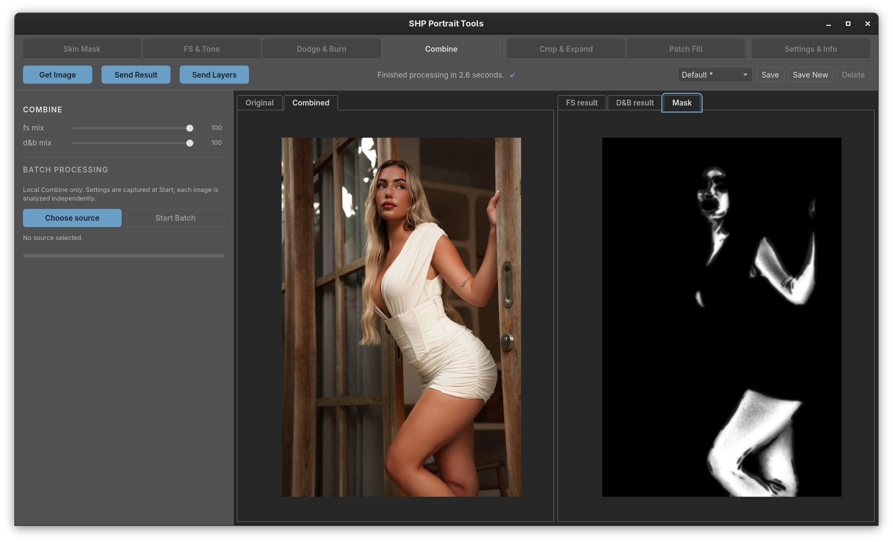

# SHP Portrait Tools

SHP Portrait Tools is a desktop companion for portrait photography on Linux and
Windows. It provides local skin retouching and editable results for PhotoCraft or
Photoshop. Skin analysis runs locally.

The tools estimate each subject's scale (S, in pixels per 63 mm), so size-based
controls adapt to the subject instead of relying on fixed pixel dimensions—helping
keep retouching behavior more consistent across close-ups, wider shots and
resolutions. The Skin Mask focuses adjustments on detected skin and helps reduce
changes to hair, clothing and background; check its coverage and refine it when
needed, since automatic detection can miss or include areas.

<p align="center">
  <a href="docs/images/readme/skin-mask.png"></a>
  <a href="docs/images/readme/fs-and-tone.png"></a>
  <a href="docs/images/readme/dodge-and-burn.png"></a>
</p>

## What’s included

### Skin Tools

- **Skin Mask** — analyze a portrait and inspect or refine the skin mask.
- **FS & Tone** — smooth skin texture and adjust skin tone while retaining detail.
- **Dodge & Burn** — work with editable tonal bands and masks.
- **Combine** — mix frequency-separation and dodge-and-burn results, including local batches (Standalone).
- **Settings & Info** — connection (Photoshop, PhotoCraft or Standalone), theme, Photoshop pairing and
  diagnostics.

The skin tools share a source image, analysis and mask settings.

<details>
<summary>View Skin Tools screenshots (6)</summary>








</details>

### AI Fill (now a separate app)

Crop & Expand and Patch Fill moved to their own project,
[SHP AI Fill](https://github.com/stefhartog/shp-ai-fill), which runs as a local web app on
your own ComfyUI. Its settings, presets and results stay in the same data folder, so
existing AI Fill data keeps working there.

### Using results

Choose the connection in **Settings & Info**:

- **Photoshop** or **PhotoCraft** — **Get Image** takes the active document from the editor and
  **Send Layers** returns editable layers (on the Skin Mask tab, the mask layer).
- **Standalone** — no editor. **Get Image** opens a local file and **Send Result** saves a numbered
  result beside it, never overwriting. Batch Processing (Combine tab) is available here.

The **Windows Photoshop 28.0 preview** is for Skin Tools. It pairs locally, reads
opaque RGB 8/16-bit documents with the exact source ICC profile, and returns editable
layer stacks, including native Hue Color Lookup. Full fidelity and group masks still
need validation. See [Photoshop setup and limitations](docs/photoshop.md) and the
[connector 0.1.14 CCX](plugins/photoshop/releases/0.1.14/shp.skin-tools.connector_PS.ccx).

### PhotoCraft connection

Tools talks to a running PhotoCraft through PhotoCraft's control server. PhotoCraft must be started with
it on, either with `--control <port> --control-token-file <file> --automation-read-root <dir>
--automation-write-root <dir>` or the matching `PHOTOCRAFT_CONTROL_PORT`, `PHOTOCRAFT_CONTROL_TOKEN_FILE`,
`PHOTOCRAFT_AUTOMATION_READ_ROOT` and `PHOTOCRAFT_AUTOMATION_WRITE_ROOT` environment variables (on Linux,
for example, in `~/.config/environment.d/`, so app-menu launches get them too). PhotoCraft creates the
token file if it is missing.

Tools must use the same port, token file and exchange folder. Put them in the `photocraft` section of
`launcher.json` (`~/.config/shp-portrait-tools/` on Linux); all six keys are required, with absolute paths:

```json
"photocraft": {
  "port": 29766,
  "token_file": "/home/you/.local/share/photocraft-control/control.token",
  "exchange": "/home/you/.local/share/photocraft-control/exchange",
  "read_root": "/home/you/.local/share/photocraft-control/exchange",
  "executable": "/usr/bin/photocraft",
  "editor_config": "/home/you/.config/photocraft"
}
```

The exchange folder must be one PhotoCraft may write to and read from (its write root, inside a read
root): Get Image and Send Layers pass files through it. A running PhotoCraft has one control server, so
other integrations that drive it must share these settings. `SHP_PC_PORT`, `SHP_PC_TOKEN_FILE`,
`SHP_PC_EXCHANGE` and `SHP_PC_READ_ROOT` in Tools' environment override the saved values. Restart Tools
after changing them; the tray's PhotoCraft line shows whether the port is reachable (not whether the
token is accepted).

## Requirements

- **Windows 10/11 or Linux** (64-bit).
- **An NVIDIA GPU with at least 8 GB of memory** and a current driver (**580 or newer**, for CUDA 13).
  The installer checks both. It does not install the graphics driver.
- **Windows:** the Edge WebView2 Runtime (built into Windows 11). **Linux:** nothing else; the window and
  tray come from the Python environment. GNOME needs the AppIndicator extension to show the tray icon.
- **Optional:** PhotoCraft or a licensed Photoshop for editor integration; ExifTool and Perl for Sony
  autofocus-point subject selection.

## Install

One command installs the latest release for the current user (no administrator/root rights). It checks the
GPU, installs [uv](https://docs.astral.sh/uv/) if needed, downloads the release, installs Python 3.13 and the
locked dependencies, downloads and verifies the models from their original sources (see
[MODELS.md](MODELS.md)), adds a Start Menu / app-menu launcher and starts Tools.

**Windows** (PowerShell):

```powershell
irm https://github.com/stefhartog/shp-portrait-tools/releases/latest/download/install.ps1 | iex
```

**Linux:**

```sh
curl -LsSf https://github.com/stefhartog/shp-portrait-tools/releases/latest/download/install.sh | sh
```

Run the same command again to **update**; settings, presets and models are kept. The app is installed in
`%LOCALAPPDATA%\Programs\shp-portrait-tools` (Windows) or `~/.local/share/shp-portrait-tools-app` (Linux).
Options (a specific release, another folder, no launch at the end, and on Windows a Desktop shortcut) are listed
at the top of [install.ps1](install.ps1) and [install.sh](install.sh). The installer never replaces an existing
shortcut or launcher file it did not write; it says so and leaves it.

Still manual: the NVIDIA driver, and for Photoshop the connector `.ccx` plus pairing
([Photoshop setup](docs/photoshop.md)).

Earlier installs kept their settings, models and logs in folders named `shp-photocraft-tools`. The first start
of this version moves them to `shp-portrait-tools` (close every Tools window first); SHP AI Fill data and the
PhotoCraft control folders stay where they are, and a note in the old folder lists what moved.

### From a checkout (development)

```sh
git clone https://github.com/stefhartog/shp-portrait-tools.git
cd shp-portrait-tools
uv python install 3.13
uv sync --locked --extra gpu
uv run --no-sync python -m shp_portrait_tools.fetch_models     # models into the default models folder
```

Then on Linux `uv run --no-sync python scripts/install_desktop.py --models
"$HOME/.local/share/shp-portrait-tools/skin/models"` and start `~/.local/bin/shp-photocraft-tools`; on Windows
`uv run --no-sync shp-portrait-tools --init-config`, then `uv run --no-sync shp-portrait-tools` (see the
[Windows notes](docs/windows-handoff.md)). The `gpu` extra supplies CUDA/cuDNN user-space libraries, not the
driver. If an older environment had both OpenCV wheels, repair `cv2` once with
`uv sync --locked --extra gpu --reinstall-package opencv-contrib-python`; the lock deliberately replaces
rtmlib's `opencv-python` with the contrib wheel.

### Optional standalone commands

Run Skin Tools as a local web app without the native desktop window:

```sh
uv run --no-sync shp-skin-tools --dir "$HOME/Pictures"
```

Open the local address printed at startup. It needs the same GPU, dependencies and models.

## Guides

- [Fresh Linux setup](docs/portrait-tools-fresh-linux-setup.md) — step-by-step installation.
- [Model requirements](MODELS.md) — model files and licenses.
- [Detailed feature notes](docs/portrait-tools-for-dummies-draft.md) — controls and workflows.
- [Skin Tools developer guide](docs/skin-tools-architecture.md) — module boundaries, request flows, and focused tests.
- [Source provenance](PROVENANCE.md) — upstream project and model references.
