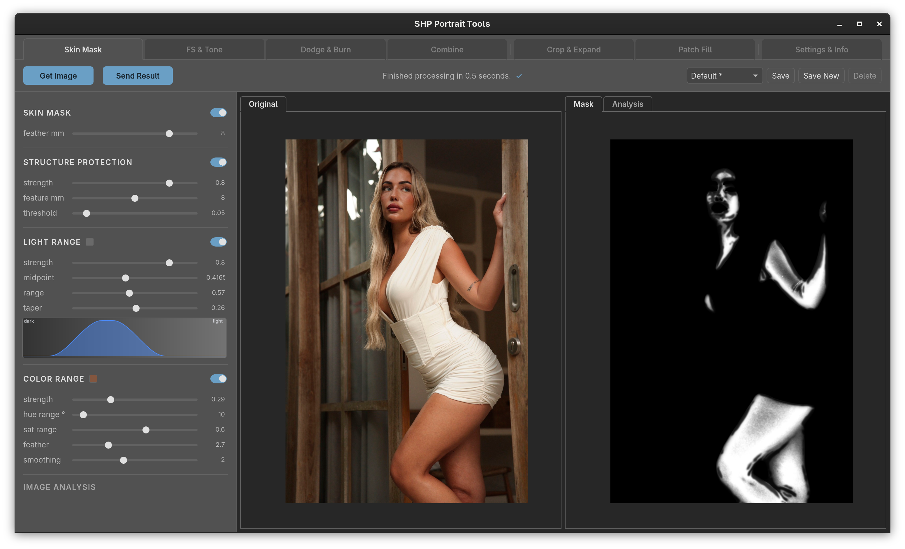
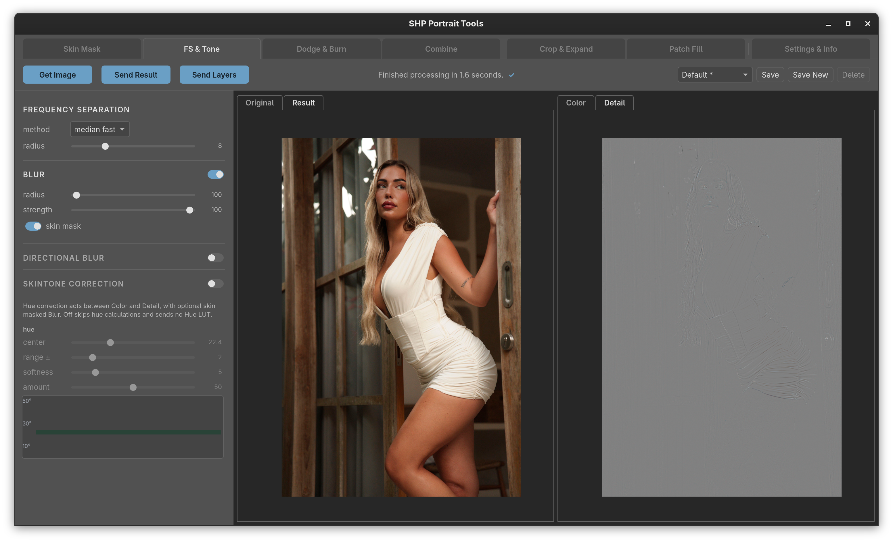
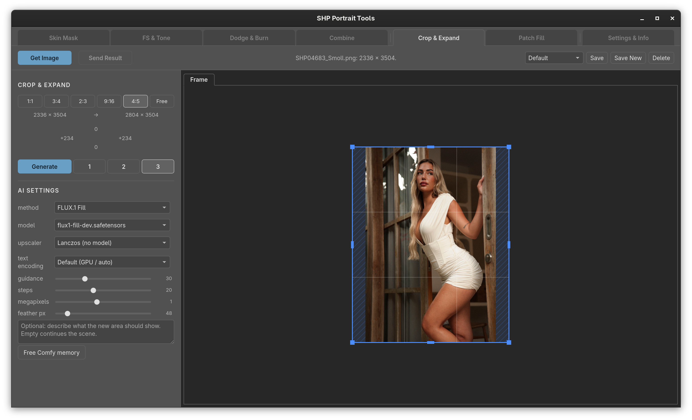
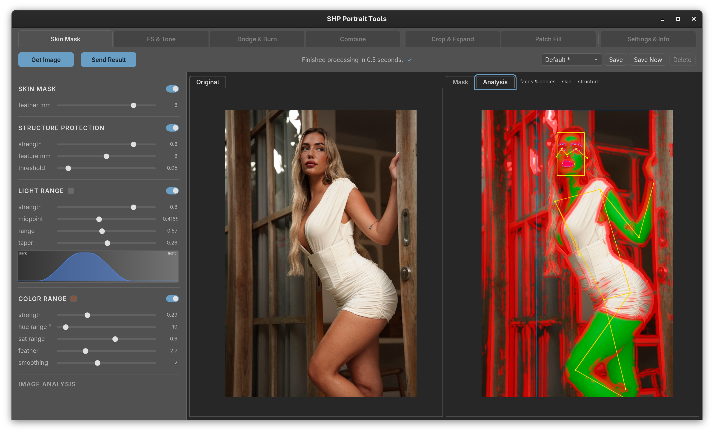
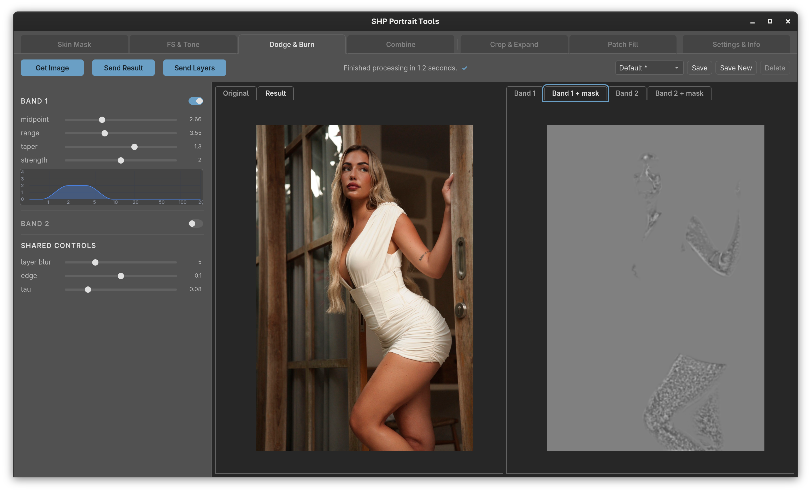
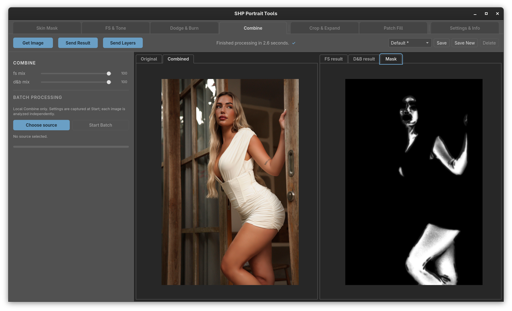
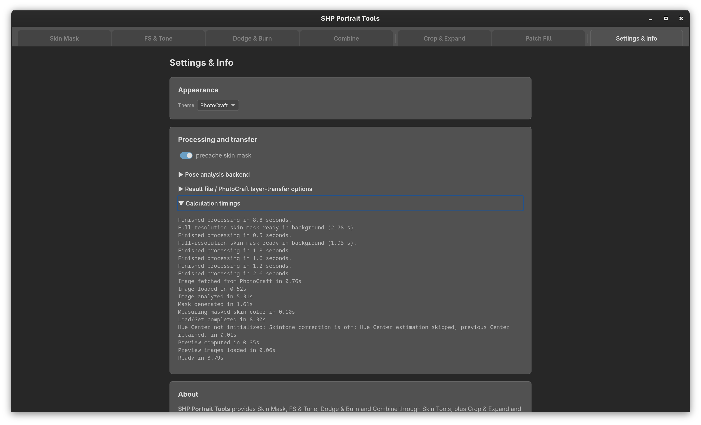
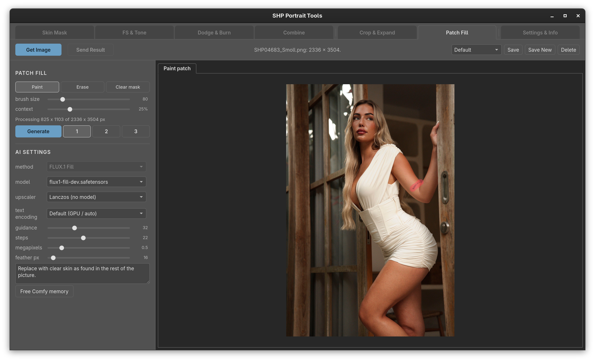

# SHP Portrait Tools

SHP Portrait Tools is a Linux desktop companion for portrait photography. It provides
local skin retouching, AI-assisted canvas expansion and fill, and editable results
that you can return to PhotoCraft. Skin analysis runs locally; image generation uses
your own ComfyUI installation and models.

<p align="center">
  <a href="docs/images/readme/skin-mask.png"></a>
  <a href="docs/images/readme/fs-and-tone.png"></a>
  <a href="docs/images/readme/crop-and-expand.png"></a>
</p>

## What’s included

### Skin Tools

- **Skin Mask** — analyze a portrait and inspect or refine the skin mask.
- **FS & Tone** — smooth skin texture and adjust skin tone while retaining detail.
- **Dodge & Burn** — work with editable tonal bands and masks.
- **Combine** — mix frequency-separation and dodge-and-burn results, including local batches.
- **Settings & Info** — shared display, mask, analysis and layer-transfer options.

The skin tools share a source image, analysis and mask settings.

<details>
<summary>View Skin Tools screenshots (6)</summary>











</details>

### AI Fill

- **Crop & Expand** — reframe a picture and generate the surroundings with FLUX.2 dev,
  FLUX.1 Fill or FLUX.2 Klein. Klein has separate settings, a soft seam blend and
  optional compatible LoRA support.
- **Patch Fill** — paint an area to replace with FLUX.1 Fill while retaining surrounding context.

<details>
<summary>View AI Fill screenshots (2)</summary>




</details>

These features need an independently installed ComfyUI, compatible models and nodes.
See [MODELS.md](MODELS.md) for exact requirements.

### Using results

Load a local image or connect to PhotoCraft to fetch the current document. Preview
and compare generated or retouched results, then save locally or send editable layers
back to PhotoCraft. PhotoCraft is optional; the main tools can work with local files.

## Dependencies

**Required:** Linux, Git, Python 3.13 and [uv](https://docs.astral.sh/uv/).

**For Skin Tools:** a compatible NVIDIA driver/GPU, the CUDA-enabled Python
dependencies, and three manually supplied ONNX models. The app does not download
these models during installation. See [MODELS.md](MODELS.md#db-three-manually-supplied-onnx-files).

**For the native desktop window:** system GTK 3, WebKit2 4.1 and AppIndicator3
bindings, plus a tray host. These are not installed by uv. Standalone web commands
do not require the desktop bindings.

**For AI Fill:** ComfyUI with its own supported GPU/PyTorch environment, the models
for the selected method, and any required custom nodes. ComfyUI and its models are
not installed by this project. A neural upscaler is optional; Lanczos resizing is
available without one.

**Optional:** PhotoCraft for editor integration; ExifTool and Perl for Sony
autofocus-point subject selection.

## Install

Clone the repository into a new folder, then install its Python environment:

```sh
git clone https://github.com/stefhartog/shp-photocraft-tools.git "$HOME/shp-photocraft-tools"
cd "$HOME/shp-photocraft-tools"
uv python install 3.13
uv sync --locked --extra gpu
```

The `gpu` extra supplies CUDA/cuDNN user-space libraries; it does not install a
graphics driver. Keep ComfyUI in its own Python environment. For package details
and other dependency options, see [pyproject.toml](pyproject.toml).

Get the three Skin Tools ONNX models and their documented hashes from
[MODELS.md](MODELS.md#db-three-manually-supplied-onnx-files), then place them in
the model folder:

```sh
mkdir -p "$HOME/.local/share/shp-photocraft-tools/dnb/models"
```

The required filenames are `yunet.onnx`, `face_landmarks.onnx` and
`selfie_multiclass_256x256.onnx`. Once they are in place, install the per-user
desktop launcher and start the app:

```sh
uv run --no-sync python scripts/install_desktop.py \
  --models "$HOME/.local/share/shp-photocraft-tools/dnb/models"
"$HOME/.local/bin/shp-photocraft-tools"
```

Skin analysis also fetches pose-estimation weights on first use; internet access is
needed then unless you prepare the cache in advance.

### Optional standalone commands

Run either service as a local web app without the native desktop window:

```sh
uv run --no-sync shp-photocraft-dnb --dir "$HOME/Pictures"
uv run --no-sync shp-photocraft-crop --dir "$HOME/Pictures" \
  --comfy http://127.0.0.1:8188
```

Open the local address printed at startup. The Skin Tools command requires the
NVIDIA GPU dependencies and model files above. The Crop & Expand command requires
ComfyUI and the selected generation models.

## Guides

- [Fresh Linux setup](docs/portrait-tools-fresh-linux-setup.md) — step-by-step installation.
- [Model and ComfyUI requirements](MODELS.md) — model files, nodes and licenses.
- [Detailed feature notes](docs/portrait-tools-for-dummies-draft.md) — controls and workflows.
- [Source provenance](PROVENANCE.md) — upstream project and model references.
